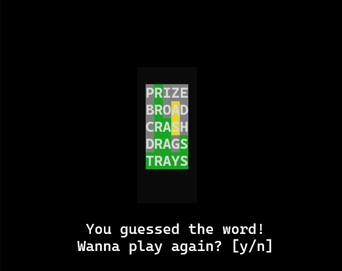

# Wordle In C++
Trying to recreate Wordle in C++. At the moment it just runs on Windows.

I used this [word bank](https://cs.stanford.edu/~knuth/sgb-words.txt).

## How To Play

After the start menu, there's a display where you can start typing your guess.

When you press `Enter` it'll tell you how close it is to the secret word. With that info try to guess the word.

If you want to quit the game you can press `,` at any moment.

## How to run

Compile all of the files in terminal, make sure that your executable file is in the same folder as the `main.cpp` file.
